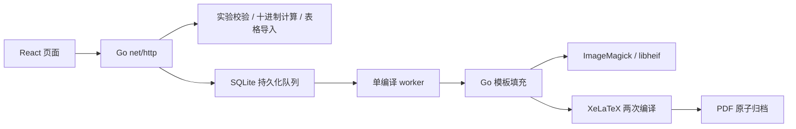

# 架构

前端保持 React/TypeScript，生产由 Go 同源提供静态资源和 `/api`；开发由 Vite 代理 `/api` 到 Go。无需独立 Nginx 才能访问应用，公网 HTTPS 可以由现有反向代理负责。

## Go 模块

| 路径 | 职责 |
| --- | --- |
| `server/cmd/reportd` | 配置、HTTP 超时、信号和服务生命周期 |
| `server/internal/domain` | Payload、保留数字文本的 Scalar、Job、Session、附件模型 |
| `server/internal/experiments` | 八种实验、单位归一化、Decimal 修约、CSV/XLSX 导入 |
| `server/internal/httpapi` | Cookie、上传限制、路由、静态文件和错误响应 |
| `server/internal/storage` | 兼容旧库的 SQLite 队列、额度、文件归档、单实例锁 |
| `server/internal/render` | TeX 转义、动态图表、图片转换和编译子进程 |
| `server/testdata` | 合成参考结果、非法输入与 XLSX 导入样本 |

领域计算没有 HTTP、数据库或 Python 依赖。XLSX 用 Go ZIP/XML 读取原始值和公式缓存，不执行公式，不访问外部链接；限制解压总量、文件数量和工作表范围。

## 持久化与调度

数据库和归档保存在 `REPORT_DATA_DIR`。一次只运行一个服务实例和一个编译 worker。SQLite 单连接保证同一实例内的额度检查和创建事务顺序执行；Go 服务启动时取得数据目录文件锁，拒绝第二个 Go 实例。旧 Python 服务不认识这个锁，迁移前必须停止它。

任务状态为 `queued → running → done/failed`。启动时将遗留 running 重新排队；受信号关闭时停止 HTTP 接收，取消当前子进程组并把在途任务重新排队。PDF 先写 `.tmp` 再重命名，最后更新数据库。文件与数据库不是同一事务，因此恢复可能重复编译，不保证 exactly-once。

失败任务也计入每日额度。匿名身份没有账号恢复能力，Cookie 丢失后不会自动关联旧报告。需要多实例、租约、账号或严格反滥用额度时应另行设计。

## 外部工具与隔离

运行镜像不包含项目 Python 后端或 Python 解释器。LaTeX 宏包在资源阶段安装，最终阶段仅复制 TeX 资源与预生成格式，避免宏包元依赖带入 Python。XeLaTeX 使用固定参数、独立工作目录、120 秒单次超时与 `-no-shell-escape`；图片使用 ImageMagick 和 libheif，校正 EXIF 方向并缩放到 3000×3600 范围内的 JPEG。编译及图片工具使用有界日志和进程组取消。

容器使用 UID/GID 10001、无新增权限、丢弃 capabilities。图片策略只允许所需位图 coder；上传阶段限制每图 8 MiB、4000 万像素，两个提交/导入请求同时处理。数据库、原图、PDF 保存在数据卷，临时编译目录最终清理。

基础依赖依据：[SQLite 驱动](https://pkg.go.dev/modernc.org/sqlite)、[Docker 多阶段构建](https://docs.docker.com/build/building/multi-stage/)。版本由 `server/go.mod`、`server/go.sum` 和 Dockerfile 固定范围；基础镜像标签仍可随补丁更新。

## 前端页面与历史演示

`App.tsx` 提供共享外壳、关于页和报告状态页面，实验路由仅从 `structuredExperimentById` 选择当前八项实验，由 `StructuredExperimentPage` 渲染。侧栏目录来自 `src/experiments.ts`，与结构化实验目录保持一致。界面及样式维护见 [前端 UI 与 CSS 指南](frontend-ui.md)。

原基础测量（长度、密度）及旧计算／图表 UI 已归档至 `legacy/basic-measurements/`，不参与 TypeScript 构建或生产部署。旧实验地址不再提供计算页，按无效实验地址规则 replace 跳转首页。共享的 JSON 导入、科学计数法文本处理和旧 Cookie 迁移仍保留，以支持当前八项实验；不会扫描或删除弃用演示留下的浏览器 Cookie。报告端及旧 SQLite 数据兼容逻辑未改动。
