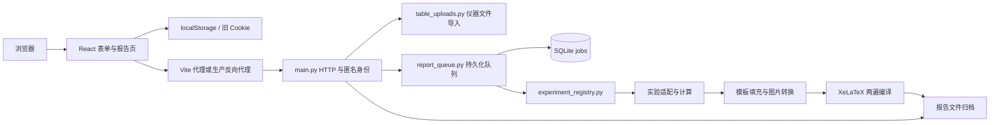

> 历史快照：本文描述迁移前的 Python 实现或当时的提案，不是当前部署指南。

# 01 现有架构

## 产品与技术边界

这是面向物理实验的浏览器录入、数据处理和 PDF 报告生成应用。八种正式报告均由后端计算并填入 LaTeX；另有长度、密度两个仅在浏览器计算的演示页。没有账号系统、管理员接口、任务删除接口或完整的报告历史分页。

前端依赖为 React 19、TypeScript 6、Vite 8、React Router、Tailwind CSS 4、Base UI/shadcn 风格组件、KaTeX 和 Recharts（版本范围见 [package.json](../../../package.json)）。后端不是 Flask/FastAPI，而是 `ThreadingHTTPServer` + `BaseHTTPRequestHandler`，由标准库提供 HTTP、SQLite、线程、Decimal 和子进程功能。显式 Python 依赖只有 Pillow、pillow-heif、openpyxl。

## 目录和关键文件

| 路径 | 当前职责 | 重构注意事项 |
| --- | --- | --- |
| `src/main.tsx` | React 初始化、BrowserRouter、样式与 UUID fallback | fallback 使用 Math.random，仅用于前端行标识，不是后端身份 |
| `src/App.tsx` | 路由、布局、首页、演示计算、报告查询、API helper | 约 740 行，多个业务和展示职责混合；开头还保留注释草稿 |
| `src/structured-experiments.ts` | 八种报告字段、单位、默认值、文案 | 前端事实来源，但不能代替后端校验 |
| `src/StructuredExperimentPage.tsx` | 表单状态、导入、校验、上传、提交、特例 UI | 约 326 行，多处 experiment.id 分支 |
| `src/experiments.ts` | 导航分组和实验名称 | 与报告配置、后端注册表存在重复维护 |
| `src/lib/experiment-data.ts` | JSON 读数导入、提示词、旧 Cookie 读写 | 提示词供用户复制；项目本身没有调用 AI 模型的接口 |
| `src/lib/structured-experiment-storage.ts` | localStorage 恢复和旧格式迁移 | 多代兼容逻辑是迁移需求，不能直接删除 |
| `src/lib/result-precision.ts` | 前端末端修约 | 输入计算仍用 Number，修约用 BigInt 十进制拆分 |
| `src/components/instrument-readings.tsx` | 油滴、扭摆仪器表格 | 保留行列含义及单位 |
| `src/components/forced-vibration-readings.tsx` | 波尔共振动态表格 | 各列数量必须联动 |
| `backend/main.py` | HTTP 路由、Cookie、multipart 解析与上传限制 | 目前手动处理协议和错误映射 |
| `backend/report_queue.py` | SQLite、每日额度、文件归档、单线程 worker | 线程锁只保护单个进程 |
| `backend/experiment_registry.py` | 八种实验分发 | `report_fields` 同时承担验证与计算 |
| `backend/*_exp.py` | 实验入口、输入兼容、模板适配 | 声速拥有独立计算和编译路径 |
| `backend/report_calculations.py` | 六类实验主要计算与作图字段 | 约 465 行，直接修改模板字段字典 |
| `backend/structured_report.py` | 公共数字校验、统计量与编译 | 参数、模板、文件系统、子进程交织 |
| `backend/fill_sound_speed.py` | 实际为公共 LaTeX 填充器 | 名称仍带声速；处理转义、科学计数法、图点和原始记录 |
| `backend/table_uploads.py` / `editable_instrument_data.py` | 文件解析与新旧录入结构互转 | 两者输出格式不同，不可合并成未经定义的 map |
| `tex/templates/` | 运行时模板、公共版式、标志、插图 | 当前编译必须保留这些资产 |
| `tex/original/`、`official/`、`zipped/` | 教材、官方资料、导出归档 | 不等同于运行时模板的单一来源 |
| `scripts/` | 开发启动、模板生成、验证、版本和打包 | 多处硬编码 npm、Python 和现有路径 |
| `legacy/` | 旧版代码和资料 | 与本轮运行时重构分开处理 |

## 前端路由与状态

| 路由 | 页面 |
| --- | --- |
| `/` | 首页 |
| `/experiments/:experimentId` | 匹配结构化报告配置，或长度/密度演示页 |
| `/reports` | 当前 Cookie 对应访客的最近 20 个任务 |
| `/reports/:jobId` | 查询指定任务，并同时取得 session |
| 其他路径 | 跳回首页 |

表单值以字符串保存，避免丢失 `30.40` 的末尾零。结构化表单写入 `phyexp_report_<experimentId>` localStorage；文件选择只存在内存，不随刷新恢复。长度与密度页仍用 Cookie。服务器身份是另一个 HttpOnly Cookie `report_user`，不能与表单 Cookie 混为一谈。

布局每 5 秒查询一次 session；报告页每 2 秒查询 session，并在指定 ID 时额外查询任务。当前两套轮询会同时运行，完成任务后也不会自动停止全部轮询。侧栏进行中数量只从最近 20 项计算，不能代表任意长度历史中的全部未完成任务。

## 提交与编译调用链

1. `generate()` 做基本数字和数量校验；有图片时提交 multipart，否则提交 JSON。
2. HTTP 读取身份、请求体和附件；表格直传时解析后覆盖 `data`、`parameters`，合并封面信息。
3. `ReportQueue.create()` 先调用 `validate_report()`；这会运行实验计算，成功后才检查额度并持久化任务。
4. worker 按 `seq` 取最早 queued 任务，设为 running；按实验 ID 调用 renderer。
5. renderer 再次计算字段，转换图片、填充模板，调用 XeLaTeX 两遍；进度主要是固定阶段值 10/25/30/45/75/95，非实时工作量百分比。
6. PDF 先写 `.tmp` 后替换正式文件，再将数据库状态设为 done。失败保存异常尾部文本。
7. 前端轮询取得 done 后展示下载链接；服务端通过任务 ID 与完整访客 ID 检查所有权。

## 两条编译路径的实际差异

| 项目 | 声速 `speed_of_sound_exp.py` | 其他实验 `structured_report.py` |
| --- | --- | --- |
| 工作目录 | `tex/templates/.sound-speed-report-<uuid>/` | `.report-data/work/.<id>-report-<uuid>/` |
| 单遍超时 | 90 秒 | 120 秒 |
| 模板资源 | 声速模板自含版式，复制标志 | 检查公共版式、标志及 figures，复制到工作目录 |
| 通用字段过滤 | 直接传入填充器 | 先过滤当前模板未使用的计算字段 |
| 特殊布局 | 独立声速版式 | 共振动态展开表格、透镜按需删除凹透镜章节 |

因此原 README 的“模板目录只需可读”“所有工作目录都在 `.report-data/work`”不适用于当前声速路径。部署容器只读模板前必须统一这两条路径。

## 模板维护

`scripts/build_report_templates.py`、`report_content.py`、`oscilloscope_template.py` 共同包含模板生成规则；运行时直接读取 `tex/templates/*.tex`。手改输出模板后重跑生成器可能覆盖改动。重构应确定哪一份是权威源，并在 CI 验证生成结果没有漂移。

填充器通过标记区和 `Field`、`MathField`、`PlotCoordinates`、`coverfield` 找字段，文本执行 LaTeX 转义，数值可转换为数学科学计数法，图点使用受限坐标格式。迁移到 Go 时必须保留这些语义，不能把任意字符串当成可信 TeX 片段。
