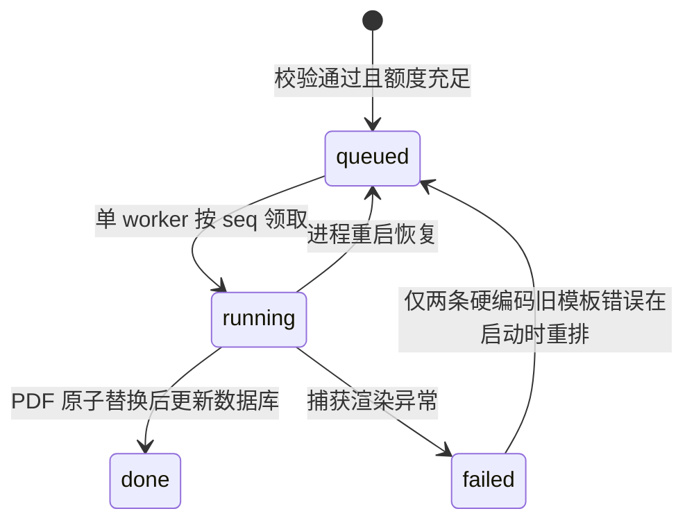

> 历史快照：本文描述迁移前的 Python 实现或当时的提案，不是当前部署指南。

# 02 HTTP 接口与持久化契约

以下描述当前实现，而非拟议的新 API。依据：[main.py](../../../legacy/python/backend/main.py)、[report_queue.py](../../../legacy/python/backend/report_queue.py)。API 为同源 `/api`，未实现通用 CORS/OPTIONS 处理，后端不提供前端静态文件。

## 端点

| 方法与路径 | 成功返回 | 主要失败 |
| --- | --- | --- |
| `GET /api/health` | 200 `{service:"report-generator",revision:<hash>}` | 仅证明进程响应，不验证编译器或存储健康 |
| `GET /api/reports/session` | 200 Session | 无效 Cookie 会创建新身份 |
| `POST /api/reports/import-table` | 200 `{data,parameters,reportInfo}` | 400 无效格式/实验/读数；不创建任务、不占额度 |
| `POST /api/reports/jobs` | 202 Job | 400 校验失败、429 当日额度耗尽、部分存储错误为 500 |
| `GET /api/reports/jobs/{id}` | 200 Job | 不存在或不属于访客均为 404 |
| `GET /api/reports/jobs/{id}/download` | 200 PDF 附件 | 未完成、不存在或无权限均为 404 |

未知 GET/POST 路径返回 404。其他方法由标准库默认处理。显式错误 JSON 为 `{"error":"中文描述"}`，没有错误码/字段路径；并非所有异常都被 HTTP 层捕获。显式响应包含 `Cache-Control: no-store`。

## Job / Session

```ts
type Job = {
  id: string;                  // UUID hex，通常为 32 位
  experimentId: string;
  status: "queued" | "running" | "done" | "failed";
  progress: number;
  stage: string;
  error: string | null;
  queueAhead: number;           // 仅 queued 时统计前面的 queued/running
  createdAt: string;            // 当前为无时区后缀的服务器本地 ISO 时间
  imageCount: number;
};
type Session = {
  userId: string;               // 完整 token 的前 8 位，仅展示
  dailyLimit: 50;
  usedToday: number;
  queueAheadIfSubmitted: number;// 全局 queued/running 数量
  jobs: Job[];                  // 当前访客按 seq 倒序，最多 20 项
};
```

数据库不会只保留 20 个任务，这只是 session 的查询上限。知道旧任务 ID 且仍有原 Cookie 时可以单独查询、下载。

## 提交内容

推荐客户端格式：

```json
{
  "experimentId": "oscilloscope",
  "data": {
    "voltage_scale": ["0.5", "0.2", "0.2", "0.2"],
    "voltage_divisions": ["5.5", "5.4", "6.6", "3.6"],
    "time_scale": ["0.10", "0.01", "0.01", "0.10"],
    "period_divisions": ["5.8", "6.2", "7.2", "5.2"],
    "reference_frequency": ["16.232", "8.116", "5.4105", "10.821"],
    "nx": ["1", "2", "3", "3"],
    "ny": ["1", "1", "1", "2"]
  },
  "parameters": {"probe_factor": "1"},
  "reportInfo": {"student": "示例学生", "student_id": "20260001", "group": "1", "date": "2026-10-14"}
}
```

`reportInfo` 可省略，公共实现允许 `student/student_id/group/date`，每项为不含控制字符、最长 120 字符的单行文本。声速额外接受旧 `partner`，但不填入模板。日期目前不是后端严格解析的日期类型。

`data` 和 `parameters` 通常要求字段集合准确匹配。公共数字解析接受字符串和数字，拒绝 bool、非有限值和绝对值大于 `1e15`；声速另有独立校验，不能将这个上界误写为全局保证。根对象未普遍禁止额外字段，历史请求还可能包含 `sourceTables`、`geometryReadings`。

### 上传约束

| 项目 | 现有限制 |
| --- | --- |
| JSON 请求 | 64 KiB；Content-Type 为 application/json |
| multipart 总体 | 30 MiB；必须 `X-Report-Request: 1` |
| multipart payload | 唯一 JSON 字段，最多 64 KiB |
| images | 同名字段可重复，最多 5 张，每张不超过 8 MiB |
| 示波器图片 | 额外限制最多 2 张 |
| 单图像素 | 不超过 40,000,000 |
| table | 至多一个文件，不超过 2 MiB；CSV/XLSX 按实验分配 |

请求必须提供合法正数 Content-Length；目前先将整个 body 读入内存，再解析 multipart，不支持流式大文件处理。未知字段和重复 payload/table 被拒绝。

图片根据签名识别 PNG/JPEG/GIF/TIFF/WebP/HEIC/AVIF，然后由 Pillow 验证，实际解码能力取决于安装的编解码支持。原图归档；编译前执行 EXIF 方向校正、RGB 转换、最长约束 3000×3600、JPEG quality=90。动画或多页图像没有逐帧生成报告页的逻辑。

当前 UI 对油滴和扭摆也显示图片区，HTTP 层不禁止这两种实验附图。原 README 关于“这两种实验只能附表”的描述已与实现不一致。

### 两种表格流程

**页面实际流程**：multipart `{payload:{experimentId,reportInfo},table}` → import-table → 解析旧计算结构 → `editable_import` 返回可编辑结构 → 浏览器可修改 → jobs 提交当前表格。

**兼容流程**：直接向 jobs 上传 table → 后端以解析结果覆盖手工 `data/parameters` → 创建任务。两者都需覆盖测试。封面信息以用户提供的非空值覆盖导入值。

import-table 代码还会接受带 `sourceTables` 的特定 JSON 结构，再做 `editable_import`；这不是推荐公开契约，嵌套形状也没有完整边界校验。Go 应将“用户上传”“内部原始表”“历史任务”拆开建模，不照搬这种信任边界。

## 匿名身份

`report_user` 为 64 位小写十六进制 token。缺失或格式不合法时生成 `secrets.token_hex(32)`。服务器只检查格式，不签名；token 相当于匿名访问凭据。Cookie 属性为 Path=/、一年 Max-Age、HttpOnly、SameSite=Lax，生产默认 Secure。

查询和下载按完整 `user_id` 隔离；前 8 位展示值不能用于认证。清除 Cookie 后会获得新身份，原报告不会自动关联回来；同样可以绕过按 Cookie 的额度限制。当前不是账号鉴权或严格反滥用方案。

## SQLite 与文件

```sql
CREATE TABLE jobs (
  seq INTEGER PRIMARY KEY AUTOINCREMENT,
  id TEXT NOT NULL UNIQUE,
  user_id TEXT NOT NULL,
  day TEXT NOT NULL,
  payload TEXT NOT NULL,
  status TEXT NOT NULL,
  progress INTEGER NOT NULL DEFAULT 0,
  stage TEXT NOT NULL,
  error TEXT,
  created_at TEXT NOT NULL
);
CREATE INDEX jobs_user_day ON jobs(user_id, day);
```

`payload` 是 JSON 文本，Decimal 序列化为字符串；没有 schema/calculation/template version。`day` 按 `Asia/Shanghai` 计算，`created_at` 来自服务器本地 `datetime.now()`，不能默认带北京时间语义。

```text
.report-data/
  reports.sqlite3
  reports/<job-id>.pdf
  original-images/<job-id>/<编号>_<清理后的原名>.<识别扩展名>
  work/.<experiment>-report-<uuid>/
```

数据库和图片/PDF 都需要迁移。CSV/XLSX 上传原文件并未在这里归档；持久化的是解析后的 payload，页面导入后提交的则是编辑后的数据。原文件证据追溯能力与图片不同。

## 任务与额度



每访客每天最多 50 个已创建任务；failed 也计数。校验失败和纯导入不创建任务，因此不计数。创建操作在单进程 RLock 与数据库事务内检查额度；图片写入也在锁内。

重启恢复 running 会从头重编译，不从中间百分比续跑。特定 `student_id` / `partner` 旧模板错误还有一次历史修复分支。没有通用重试、取消、幂等键、任务租约或多进程互斥。

当前是至少可能重做一次的处理行为，不能宣称 exactly-once。PDF 成功写入而数据库尚未提交时崩溃，会导致重编译；文件系统和 SQLite 不是同一个原子事务。
